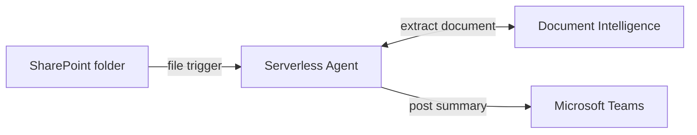

<!--
---
name: SharePoint document review announcer with Azure Functions Serverless Agents
description: Review new SharePoint PDF and DOCX files and post grounded briefs to Microsoft Teams.
page_type: sample
languages:
- azdeveloper
- python
- bicep
products:
- azure-functions
- azure-ai-foundry
- azure-ai-document-intelligence
- microsoft-teams
- sharepoint
---
-->

# Serverless Document Review Announcer

A markdown-first Azure Functions serverless agent that reviews new SharePoint
PDF and DOCX files and posts an evidence-backed brief to one Microsoft Teams
channel. Python tools own retrieval, validation, grounding, idempotency, and
publication; the agent owns only the document review.

> **Preview sample:** Connector Namespace, its Azure Functions extension, and
> `azure-connectors` are preview technologies. Use synthetic or non-sensitive
> documents only. This is a proof of concept, not a production reference
> architecture.

## What it does

- Watches one configured SharePoint library folder for new files.
- Retrieves the file privately through an Entra-authorized connector.
- Extracts bounded Markdown with Azure AI Document Intelligence.
- Produces a summary, changes, risks, questions, and review focus grounded in
  exact source excerpts.
- Posts escaped HTML to one fixed Teams channel with at-most-once delivery.
- Suppresses duplicate versions and publishes factual notices for unsupported
  or failed documents instead of fabricating a review.

## Prerequisites

- An [Azure subscription](https://azure.microsoft.com/free/) with permission to
  create resources and role assignments
- [Azure Developer CLI (`azd`)](https://learn.microsoft.com/azure/developer/azure-developer-cli/install-azd)
- [Azure CLI](https://learn.microsoft.com/cli/azure/install-azure-cli)
- [uv](https://docs.astral.sh/uv/) and Python 3.13
- The preview Connector Namespace Azure CLI extension
- A least-privileged Microsoft 365 identity that can read the source folder and
  post to the destination channel

Install the Connector Namespace extension:

```bash
# macOS / Linux
curl -fsSL https://aka.ms/connector-namespace-cli-install | bash
```

```powershell
# Windows PowerShell
irm https://aka.ms/connector-namespace-cli-install-ps | iex
```

## Quickstart

### 1. Configure the source and destination

```bash
azd auth login
az login
azd env new document-review
azd env set AZURE_LOCATION eastus2
azd env set CONNECTOR_NAMESPACE_LOCATION westcentralus

azd env set SHAREPOINT_SITE_URL "https://<tenant>.sharepoint.com/sites/<site>"
azd env set SHAREPOINT_FOLDER_PATH "/Shared Documents/Document Reviews"
azd env set TEAMS_GROUP_ID "<team-guid>"
azd env set TEAMS_CHANNEL_ID "19:<channel-id>@thread.tacv2"
```

The SharePoint library defaults to `Documents`. Set
`SHAREPOINT_LIBRARY_NAME` only when the library has another title. See
[Deploy](docs/deploy.md) for help finding the SharePoint and Teams values.

### 2. Provision and deploy

```bash
azd up
```

The postdeploy hook registers the SharePoint trigger and generates synthetic
PDF and DOCX files under `samples/documents/`. It does not grant Microsoft 365
consent or upload a document.

### 3. Authorize the customer connections

Open [Connector Namespaces](https://connectors.azure.com/), select the deployed
namespace, and authorize these connections with the least-privileged customer
identity:

- `sharepoint-document-source`
- `teams-review-announcements`

Wait until both connections show **Connected** or **Enabled**.

### 4. Try it

Upload `samples/documents/project-atlas-review.pdf` to the configured
SharePoint folder. The trigger polls every five minutes. The Teams channel
should receive one grounded review with a link to the source document.

Each successful version is claimed once. For another run, upload a newly named
file or a new SharePoint version rather than reusing a completed version.

## How it works



The trigger and agent instructions live in
[`src/agents/document_review_announcer.agent.md`](src/agents/document_review_announcer.agent.md).
Two Python tools form the deterministic boundary: one validates, claims,
retrieves, and extracts the file; the other validates evidence and publishes to
Teams. File bytes, extracted text, generated reviews, and Teams message bodies
are never persisted or written to application logs.

[How it works](docs/how-it-works.md) | [Use cases](docs/use-cases.md) |
[Customize](docs/customize.md) | [Deploy](docs/deploy.md) |
[Troubleshooting](docs/troubleshooting.md)

## Run the tests

Connector Namespace has no local emulator, so the test suite exercises the full
pipeline with fake SharePoint, Teams, Document Intelligence, and Table clients.

```bash
cd src
uv sync --locked
uv run pytest
```

See [Troubleshooting](docs/troubleshooting.md#local-function-host) for the
optional local Functions host setup.

## Clean up

```bash
azd down --purge
```

## Learn more

- [Serverless agents runtime in Azure Functions](https://learn.microsoft.com/azure/azure-functions/functions-serverless-agents-runtime)
- [Azure Functions Flex Consumption](https://learn.microsoft.com/azure/azure-functions/flex-consumption-plan)
- [SharePoint connector](https://learn.microsoft.com/connectors/sharepointonline/)
- [Microsoft Teams connector](https://learn.microsoft.com/connectors/teams/)
- [Azure AI Document Intelligence](https://learn.microsoft.com/azure/ai-services/document-intelligence/)

## License

[MIT](LICENSE)