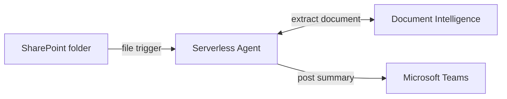

# How it works

Back to the [README](../README.md).

A new SharePoint file triggers one agent run. Deterministic Python tools own all
security-sensitive actions; the model reviews only the bounded Markdown returned
by the preparation tool.

## Why use an agent?

Review documents are unstructured. Decisions, risks, changes, and open questions
can appear in prose, tables, or headings and vary by author. An agent is useful
for interpreting that material and organizing a review brief.

An agent is not useful for deciding where to read or write, enforcing size and
page limits, claiming a version, or proving that a finding came from the source.
Those responsibilities stay in code. This division is the central pattern the
sample demonstrates.

## Architecture



The Function runs on Flex Consumption and scales to zero when no connector event
is being processed.

## One file, step by step

1. Connector Namespace polls the configured folder every five minutes and sends
   file properties to `document_review_announcer`.
2. [`trigger_payloads.py`](../src/document_review/trigger_payloads.py) normalizes
   the preview connector's nested or encoded payload into `body.value[]`.
3. [`prepare_review_document.py`](../src/tools/prepare_review_document.py)
   allow-lists the folder, validates the extension and declared size, and claims
   the file version in Azure Table Storage.
4. [`connectors.py`](../src/document_review/connectors.py) reads bounded metadata
   and file bytes through the Entra-authorized SharePoint connection.
5. [`documents.py`](../src/document_review/documents.py) sends the bytes to
   Document Intelligence and enforces the page and extracted-character limits.
6. The agent treats the extracted Markdown as untrusted source material and
   drafts only claims supported by exact excerpts.
7. [`publish_review_announcement.py`](../src/tools/publish_review_announcement.py)
   checks every excerpt against the claim-bound source, escapes source-derived
   HTML, and posts to the configured Teams channel.
8. [`state.py`](../src/document_review/state.py) marks the claim complete and
   suppresses the same version on later polls.

## Responsibility boundary

| Responsibility | Owner |
| --- | --- |
| Interpret prose and organize the review | Agent instructions |
| Select the SharePoint source and Teams destination | Deployment configuration |
| Validate path, type, size, and page count | Python tools |
| Retrieve bytes and extract Markdown | Python tools and Azure services |
| Require exact source evidence | Publication tool |
| Escape Teams HTML | Publication tool |
| Claim versions and prevent duplicate sends | Azure Table state machine |
| Store OAuth tokens | Connector Namespace |

The publication tool schema intentionally has no team or channel parameter, so
document text and model output cannot redirect a message.

## Privacy and delivery semantics

- The Function uses a user-assigned managed identity for Azure resources.
- Delegated Microsoft 365 OAuth tokens remain in Connector Namespace.
- File bytes and extracted Markdown exist only in process memory.
- Extracted Markdown is cached briefly under a random claim reference and is
  removed after publication or expiry.
- `logger: false` prevents the preview agents runtime from logging model and tool
  content. `ENABLE_SENSITIVE_DATA` is also `false`.
- A Teams send is at most once. Once sending starts, an ambiguous connector
  result becomes `publication_unknown` and is not retried automatically.

At-most-once delivery favors avoiding duplicate channel posts. A production
system should add an operator reconciliation path for indeterminate sends.

## Preview compatibility layer

The pinned `azure-connectors==0.4.0b1` transport decodes every successful body as
UTF-8, including binary SharePoint file content. Its SharePoint dataset route
also requires double URL encoding. Both details are isolated in
[`_connector_compat.py`](../src/document_review/_connector_compat.py) and covered
by focused tests.

The trigger normalizer also adapts the current preview runtime's serialized
connector payload before the agent sees it. Treat these as compatibility code:
when upgrading either preview package, run the connector and trigger tests before
removing or changing them.

## Repository layout

```text
src/
  agents/document_review_announcer.agent.md  # trigger and review instructions
  document_review/                           # connectors, extraction, state
  tools/                                     # deterministic agent tools
  function_app.py                            # Functions entry point
  agents.config.yaml                         # runtime defaults
  host.json                                  # Functions host configuration
  pyproject.toml / uv.lock                   # dependency source of truth
infra/                                       # azd and modular Bicep
scripts/create_sample_documents.py           # synthetic PDF/DOCX generator
samples/                                     # trigger fixture and generated files
tests/                                       # unit and contract tests
azure.yaml                                   # service and deployment hooks
```

Next: [Use cases](use-cases.md) | [Customize](customize.md) |
[Deploy](deploy.md) | [Troubleshooting](troubleshooting.md)